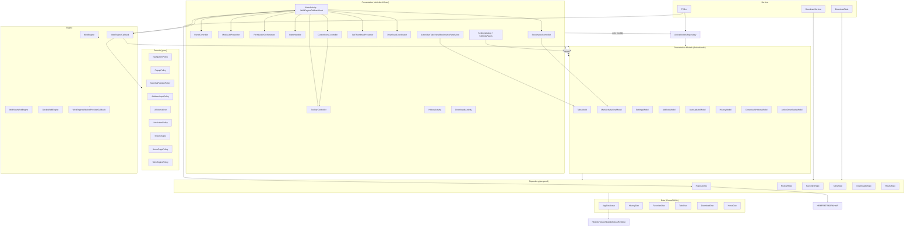

# Architecture (post-MVVM refactor)

This document describes the current architecture: the view-purity pass, the split of the main
screen's UI work into view collaborators, and the follow-up pass that moved the remaining model-side
UI side effects behind injected host interfaces. It includes a high-level
diagram (Mermaid) and notes on contracts, dependency direction, and data flow.

## Key Contracts

- **ActiveModel**: Custom ViewModel-like with `modelScope` (SupervisorJob + Dispatchers.Main.immediate). Lifecycle tied to active users via `ActiveModelsRepository`. Models are constructed via reflection with no-arg ctor when all primary ctor params have defaults.
- **Observables**: `ObservableValue<T>`, `ObservableList<T>` extend custom `Subscribable` with lifecycle-aware subscribe. Views observe; models mutate state.
- **WebEngineCallback**: Plain class (per-tab adapter), not an inner Activity. Injected with models; UI access only via `WebEngineCallbackHost`. Pure policy delegated to `domain/`. `DownloadRequest` bundles download params.
- **WebEngineCallbackHost**: View seam implemented by `MainActivity` (activity operations, UI updates, panels, menus, permissions, fullscreen).
- **TabViewHost**: View seam implemented by `MainActivity` (`createView`/`attachEngineToWindow`), injected into `TabsModel.changeTab` so the model never handles a `ViewGroup`.
- **AutoUpdateHost**: View seam implemented by `MainActivity` (dialogs, install-permission handling, download), injected into `AutoUpdateModel.showUpdateDialogIfNeeded` so the model owns only the decision.
- **WebViewDataDirManager**: The isolated WebView data/cache directories an incognito session runs on; `DefaultWebViewDataDirManager` is the WebView-engine implementation, injected into `MainActivityViewModel`.
- **Domain**: Framework-free decision objects (`NavigationPolicy`, `PopupPolicy`, `SiteDomains`, `AddressInputPolicy`, `UrlNormalizer`, `LinkActionPolicy`, `NewTabPositionPolicy`, `HomePagePolicy`, `WebEnginePolicy`).
- **Repositories**: One per DAO, all `suspend`. `Repositories` is manual DI container (lazy singletons). Models have ctor params with production defaults for testability.

## Main-screen view collaborators

`MainActivity` is the host (`WebEngineCallbackHost`) and the composition root for the screen. Its UI
work is split into cohesive collaborators, each constructed in `onCreate` with the binding, models and
callbacks it needs — they never reach into the activity's private members:

| Collaborator | Owns | Wired with |
|---|---|---|
| `PanelController` | Tabs/bookmarks panel visibility and the focus hand-off (claims the container focus synchronously via `requestFocusFromTouch()`, then hands the focus to a row once the content is settled). | binding + focus-engine callback |
| `ToolbarController` | Toolbar overlay show/hide/style, the menu toggle, the auto-hide call sites (currently a no-op under keep-toolbar-open), and the in-page fullscreen window flags. | activity, binding, keep-screen-on reader, focus-engine callback |
| `MediaListPresenter` | The "streams on this page" list dialog and its background metadata prefetch. | activity + `TabsModel` |
| `PermissionOrchestrator` | Routing of permission/activity-result callbacks (voice search → engine → downloads) and the shared request-code counter. | `VoiceSearchHelper`, `DownloadCoordinator`, engine-permission callback |
| `IntentHandler` | Deep links, the "open in same tab" extra, and the History activity result. | `TabsModel` + navigate/open-tab/change-tab/auto-hide callbacks |
| `BookmarksController` | Bookmark panel toggle, bookmark CRUD and favorite editing. | activity, lifecycle scope, binding, `MainActivityViewModel`, `PanelController` + current-tab/navigate callbacks |
| `CursorMenuController` | Fullscreen enter/exit, the cursor menu, the link-actions popup and the external-app dialog. | activity, binding, `Handler`, `ToolbarController`, `BackNavigationEventsAdapter` |
| `TabThumbnailPresenter` | The debounced thumbnail repaint and its bitmap/placeholder rendering. | binding, `Handler`, lifecycle scope + keep-toolbar-open/current-tab predicates |
| `DownloadCoordinator` | The download permission walk and the download-service binding, through `DownloadHost`. | `DownloadHost` + on-download-started callback |

These are view collaborators, not models: they hold no domain state and only render/forward to the
binding, the models and the callbacks handed to them.

The same rule applies where a model would otherwise need the screen directly: `TabsModel.changeTab`
takes a `TabViewHost`, `AutoUpdateModel.showUpdateDialogIfNeeded` takes an `AutoUpdateHost`,
`DownloadCoordinator` talks to a `DownloadHost`, and `AdblockModel` publishes a `loadError` flag the
host renders. All are implemented by `MainActivity`.

## High-Level Diagram

## Dependency Direction

- Domain: no Android deps (pure).
- Repository: depends on Room/DAOs/entities.
- Presentation Models: depend on Repositories and domain; avoid View references (small controlled seams).
- Engine Adapter: depends on models, domain, host interface.
- View/Activity: depends on models (observables) and host interface; never on Repositories/DAOs/AppDatabase. The view collaborators depend on the binding/models/callbacks they are wired with.
- Service layer: may depend on Repositories (allowed).

## Data Flow (example: engine page load)

1. WebEngine calls `WEH.onPageStarted(url)` → `WebEngineCallback.onPageStarted` → `TabsModel.onPageStarted(...)` updates tab → `host.updateAddressBoxIfCurrentTab`/`host.onWebViewUpdated` → Activity updates UI.

## Notes

- MainActivity reads `config` directly only for engine-construction checks (before models exist) — deliberate.
- Popup decisions use `runBlocking` in the synchronous engine callback (documented).
- History search does a partial (`%query%`) match on the title or the url, newest first.
- APK installs (DownloadsActivity and DownloadService) both go through `InstallPermissionHelper.launchInstaller`, which is MediaStore-aware (a `content://` Uri from API 30, an absolute path below).
- The `ActiveModelsRepository` no-arg-constructor contract is pinned by a reflection test over the known models (`ActiveModelsContractTest`).
- Rendered diagrams live next to this file: `ARCHITECTURE.plantuml`/`.png`/`.svg`/`.pdf` (overview) and `ARCHITECTURE-LAYERED.*` (layered view with component descriptions). PDFs are produced from the SVG (PlantUML's `-tpdf` needs Batik, which is not available here).
