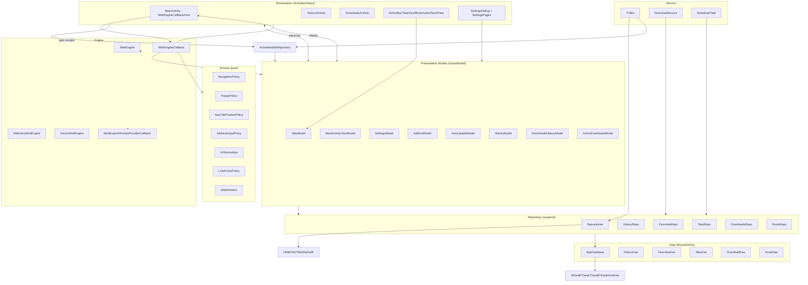

# Architecture (post-MVVM refactor)

This document summarizes the current architecture after the view-purity pass on branch `refactor/mvvm`. It includes a high-level diagram (Mermaid) and notes on contracts, dependency direction, and data flow.

## Key Contracts

- **ActiveModel**: Custom ViewModel-like with `modelScope` (SupervisorJob + Dispatchers.Main.immediate). Lifecycle tied to active users via `ActiveModelsRepository`. Models are constructed via reflection with no-arg ctor when all primary ctor params have defaults.
- **Observables**: `ObservableValue<T>`, `ObservableList<T>` extend custom `Subscribable` with lifecycle-aware subscribe. Views observe; models mutate state.
- **WebEngineCallback**: Plain class (per-tab adapter), not an inner Activity. Injected with models; UI access only via `WebEngineCallbackHost`. Pure policy delegated to `domain/`. `DownloadRequest` bundles download params.
- **WebEngineCallbackHost**: View seam implemented by `MainActivity` (activity operations, UI updates, panels, menus, permissions, fullscreen).
- **Domain**: Framework-free decision objects (`NavigationPolicy`, `PopupPolicy`, `SiteDomains`, `AddressInputPolicy`, `UrlNormalizer`, `LinkActionPolicy`, `NewTabPositionPolicy`).
- **Repositories**: One per DAO, all `suspend`. `Repositories` is manual DI container (lazy singletons). Models have ctor params with production defaults for testability.

## High-Level Diagram

## Dependency Direction

- Domain: no Android deps (pure).
- Repository: depends on Room/DAOs/entities.
- Presentation Models: depend on Repositories and domain; avoid View references (small controlled seams).
- Engine Adapter: depends on models, domain, host interface.
- View/Activity: depends on models (observables) and host interface; never on Repositories/DAOs/AppDatabase.
- Service layer: may depend on Repositories (allowed).

## Data Flow (example: engine page load)

1. WebEngine calls `WEH.onPageStarted(url)` → `WebEngineCallback.onPageStarted` → `TabsModel.onPageStarted(...)` updates tab → `host.updateAddressBoxIfCurrentTab`/`host.onWebViewUpdated` → Activity updates UI.

## Notes

- MainActivity reads `config` directly only for engine-construction checks (before models exist) — deliberate.
- Popup decisions use `runBlocking` in the synchronous engine callback (documented).
- History search uses exact substring match in current behavior (pinned by test; fix is behavior change).
